<p align="center">
  
</p>

<p align="center">
  <a href="https://www.linkedin.com/in/walker-yturbides-8bba011b4"></a>
  
  
</p>

```console
walker@shield:~$ whoami
Walker Yturbides · M.S. Cybersecurity @ Northeastern (Dec 2027)

walker@shield:~$ cat background.txt
U.S. Army veteran · former P&G OT/ICS engineer · MBA

walker@shield:~$ cat focus.txt
offensive security · secure architecture · post-quantum crypto · GRC for finance

walker@shield:~$ ./next --role
cybersecurity co-op · fintech & financial services
```

## 🧭 About me

- 🎓 **M.S. Cybersecurity** candidate at **Northeastern University** (Khoury College), graduating December 2027. I also hold an MBA (UMGC) and a B.S. in Electronic Engineering Technology (Wentworth).
- 🏭 **Former OT/ICS engineer at Procter & Gamble.** I hardened 400+ plant computers to an Active Directory standard, wrote allow-list firewall rules from traffic analysis, and led HMI upgrades across 9 production lines.
- 🪖 **U.S. Army veteran.** I led a 16-soldier combat engineer team in South Korea.
- 🐞 **Responsible disclosure.** I found and privately reported two vulnerabilities in my course's grading infrastructure, including an insecure-deserialization risk (CWE-502) that I assessed as Critical. I proved it on an isolated mock and never touched the live system.
- 🔬 **Research.** I'm leading a pre-registered study of whether separate Solana wallets reveal common control, across 218M trades and 7M wallets.
- 🎯 **Goal:** secure the systems that move money, as a security engineer in fintech and financial services.
- 🌎 Bilingual in English and Spanish.

## 🛡️ Featured work

<table>
  <tr>
    <td width="50%" valign="top">
      <h3><a href="https://github.com/007Byte/Quantum_Shield">🔐 Quantum Shield</a></h3>
      Zero-knowledge, post-quantum encrypted file vault for USB, web, mobile and desktop. All crypto runs on the client, so the server never sees plaintext.
      <br/><br/>
      <b>Crypto:</b> hybrid X25519 + ML-KEM-1024, AES-256-GCM-SIV, Argon2id, SRP-6a, Shamir recovery<br/>
      <b>Pipeline:</b> 10 GitHub Actions workflows gating 4,300+ tests, with Semgrep, gosec, gitleaks, Snyk, Trivy, OWASP ZAP, cargo-fuzz, SBOMs and cosign signing
      <br/><br/>
      
      
      
    </td>
    <td width="50%" valign="top">
      <h3><a href="https://github.com/007Byte/web-recon">🌐 web-recon</a></h3>
      Python toolkit for <b>authorized</b> web testing: HTTP request smuggling (CL.TE / TE.CL), cache poisoning and deception, CPDoS, header splitting and multi-stage chains. It grew out of course-lab work where I demonstrated denial-of-service impact in an isolated environment.
      <br/><br/>
      
      
    </td>
  </tr>
  <tr>
    <td width="50%" valign="top">
      <h3><a href="https://github.com/007Byte/password-policy">🔑 password-policy</a></h3>
      Password-strength policy module that implements NIST SP 800-63B Rev. 4 and the OWASP Authentication Cheat Sheet. It scores length first, checks against breached-password lists, and detects personal information in passwords.
      <br/><br/>
      
      
      
    </td>
    <td width="50%" valign="top">
      <h3><a href="https://github.com/007Byte/ctf-hackathon-kit">🚩 ctf-hackathon-kit</a></h3>
      Offline-ready CTF kit with checklists, cheatsheets and custom tooling for PCAP triage, nmap parsing, binary triage and headless Ghidra. It also includes a malware write-up that maps a typosquat npm dropper to 11 MITRE ATT&amp;CK techniques, with IOCs and a Sigma rule.
      <br/><br/>
      
      
      
    </td>
  </tr>
  <tr>
    <td width="50%" valign="top">
      <h3>🏠 CIA_Home_Shield <sub><i>(private)</i></sub></h3>
      My home network, run like a small enterprise: 6 segmented VLANs under default-deny, IPS with honeypots, DNS locked to the gateway, WPA3-only Wi-Fi, a WireGuard tunnel with a tested kill switch, and off-host logging to a Raspberry Pi 5. Python checks on the UniFi API verify 100+ settings every day and flag drift, and every change goes through approval, rollback and evidence.
      <br/><br/>
      
      
      
    </td>
    <td width="50%" valign="top">
      <h3><a href="https://github.com/007Byte/finance-tracker-dashboard">💹 WealthUp</a></h3>
      Full-stack personal-finance platform with budgeting, mortgage planning, investment analysis and an AI coach. It runs on React 19 and Expo with an Express and Supabase back end, Postgres row-level security, AES-256-GCM and Argon2id, and a documented security audit.
      <br/><br/>
      
      
      
    </td>
  </tr>
</table>

## 🧰 Tech arsenal

| | |
|---|---|
| **Offensive** |      |
| **Defense** |       |
| **Crypto & DevSecOps** |       |
| **Languages** |          |
| **Platforms** |       |
| **GRC** |      |

## 🗺️ Path so far

| | Role | Where | When |
|:---:|---|---|---|
| 🎓 | M.S. Cybersecurity | Northeastern University, Khoury College | 2025 – Dec 2027 |
| 🪖 | Combat Engineer Team Leader | U.S. Army, 11th Engineer Battalion | 2021 – 2024 |
| 🎓 | MBA, GPA 3.83 | University of Maryland Global Campus | 2023 |
| 🏭 | Power Controls & Information Systems Engineer (OT/ICS) | Procter & Gamble | 2014 – 2018 |
| 🎓 | B.S. Electronic Engineering Technology | Wentworth Institute of Technology | 2014 |

## 🔭 Right now

- 🔬 Wrapping up the Solana wallet-linkability study for CS 6983
- 🏠 Hardening CIA_Home_Shield: assurance, recovery drills and controlled admin access
- 📚 CY 5010, Foundations of Information Assurance: post-quantum file sharing and network security labs

## 🤝 Let's connect

<p align="left">
  <a href="https://www.linkedin.com/in/walker-yturbides-8bba011b4"></a>
</p>

<p align="center">
  <i>"Read More, Learn More, Change the Globe."</i><br/>
  <sub>Last updated November 2026</sub>
</p>
